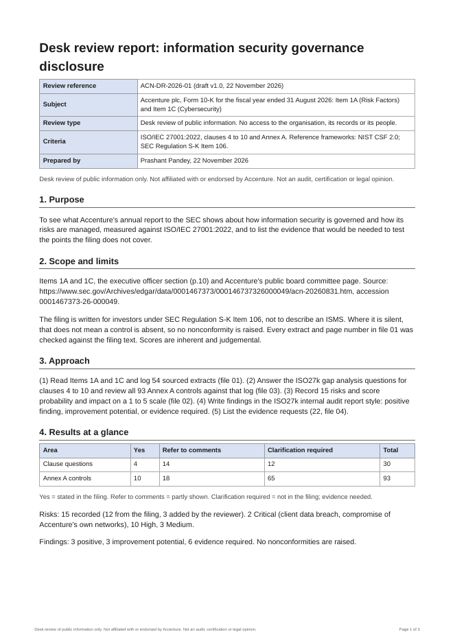
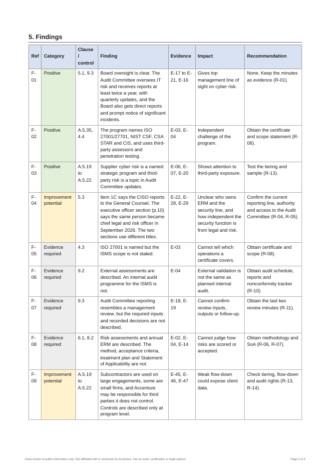
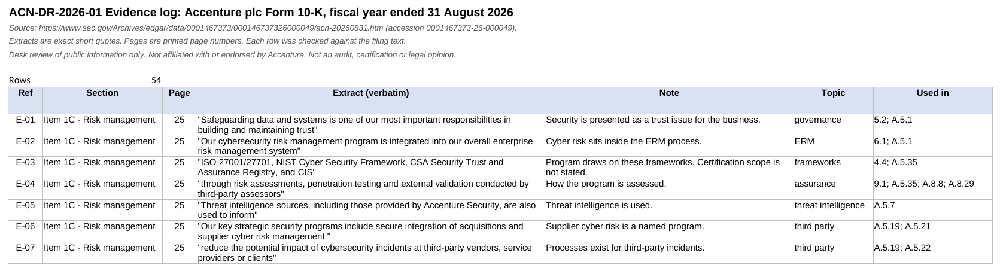
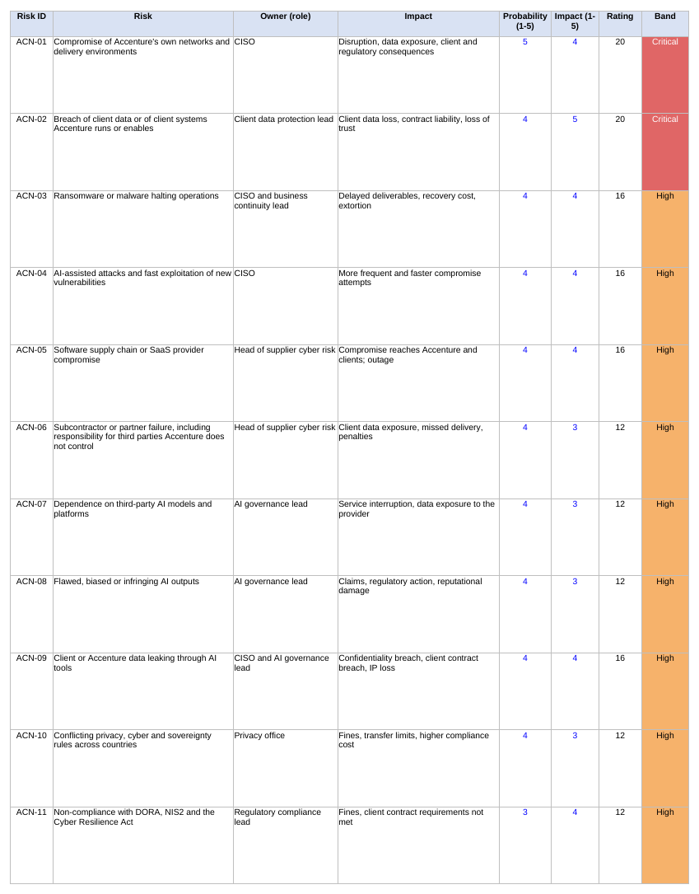
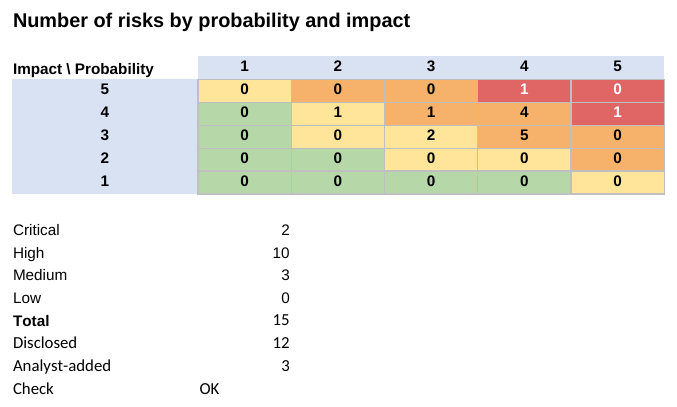
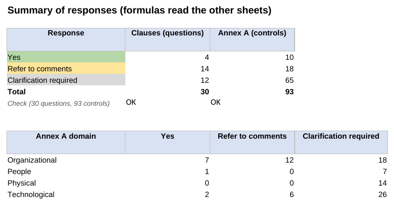
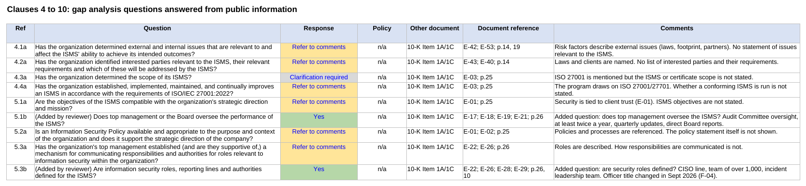
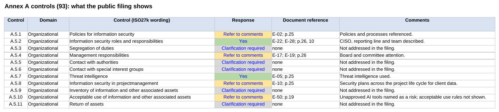
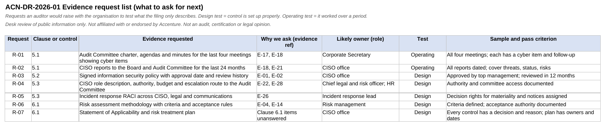
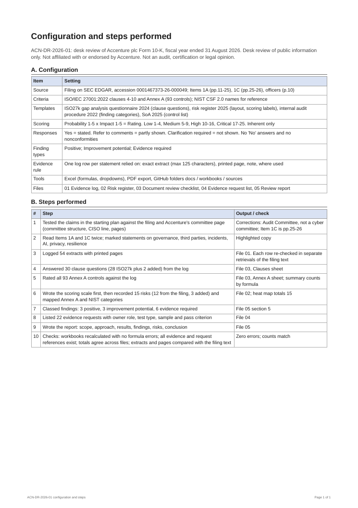

# ISO 27001 Desk Review: Accenture plc FY2026 Form 10-K


> Desk review of public information only. Not affiliated with or endorsed by Accenture. Not an audit, certification or legal opinion.

**Review reference:** ACN-DR-2026-01 · **Subject:** Accenture plc Form 10-K, fiscal year ended 31 August 2026 (Items 1A and 1C) · **Criteria:** ISO/IEC 27001:2022

## What this is

A GRC portfolio project. It reads what Accenture's annual report to the SEC says about how information security is governed, tests that against ISO/IEC 27001:2022 (clauses 4 to 10 and all 93 Annex A controls), records the risks, and lists the evidence a real auditor would ask for next. Every statement relied on is logged with an exact short quote and the printed page number.

**Skills shown:** ISO 27001 clause and Annex A review, evidence logging, risk assessment (probability x impact), audit findings (positive / improvement potential / evidence required), evidence request (PBC) lists, Excel with formulas and dropdowns, concise audit reporting.

## Result in brief

- Board oversight is clear: the Audit Committee oversees IT risk, receives management reports at least twice a year and quarterly updates. There is no separate Board cybersecurity committee.
- Independent assessors and penetration testing are named. Frameworks drawn on include ISO 27001/27701, NIST CSF, CSA STAR and CIS.
- Not shown in the filing: ISMS scope, internal audit programme, management review records, risk assessment method. These are listed as *evidence required*, not as failures.

| Measure | Result |
| --- | --- |
| Evidence rows | 54 (exact extracts, printed pages) |
| Clause questions | 30: 4 Yes, 14 Refer to comments, 12 Clarification required |
| Annex A controls | 93: 10 Yes, 18 Refer to comments, 65 Clarification required |
| Risks | 15 (12 from the filing, 3 added): 2 Critical, 10 High, 3 Medium |
| Findings | 12: 3 positive, 3 improvement potential, 6 evidence required. No nonconformities |
| Evidence requests | 22 (17 High priority) |

## Read it in 5 minutes

1. [`docs/05_Review_Report.pdf`](docs/05_Review_Report.pdf): 3-page report.
2. [`docs/Configuration_and_Steps_One_Page.pdf`](docs/Configuration_and_Steps_One_Page.pdf): setup and steps on one page.
3. Open the workbooks in [`workbooks/`](workbooks/) for the detail.

## Screenshots

**Report (pages 1 and 2)**

<p>


</p>

**01 Evidence log**: each row is a verbatim extract with page, note and where it is used.



**02 Risk register** and heat map




**03 Document review checklist**: summary counts are formulas that read the other sheets.





**04 Evidence request list**



**Configuration and steps (one page)**



## Repository layout

```
.
├── README.md
├── LICENSE
├── docs/
│   ├── 05_Review_Report.pdf
│   └── Configuration_and_Steps_One_Page.pdf
├── workbooks/
│   ├── 01_Evidence_Log.xlsx
│   ├── 02_Risk_Register.xlsx
│   ├── 03_Document_Review_Checklist.xlsx
│   └── 04_Evidence_Request_List.xlsx
├── sources/
│   └── SOURCES.md
└── assets/screenshots/
```

## Method

1. Read Items 1A and 1C and log sourced extracts (file 01).
2. Answer the ISO27k gap analysis questions for clauses 4 to 10 and review all 93 Annex A controls against the log (file 03).
3. Record risks and score probability and impact, 1 to 5 each. Bands: Low 1-4, Medium 5-9, High 10-16, Critical 17-25. Inherent scores only (file 02).
4. Write findings in the ISO27k internal audit report style (report section 5).
5. List the evidence needed to test what the filing does not show (file 04).

Response scale: **Yes** = stated in the filing; **Refer to comments** = partly shown; **Clarification required** = not in the filing. There is no "No", because silence in a public filing does not prove a control is missing.

## Limits

Public information only. Nothing was tested. Scores are inherent and judgemental. The filing is written for investors under SEC Regulation S-K Item 106, not to describe an ISMS.

## Links

- Accenture Form 10-K (FY2026): https://www.sec.gov/Archives/edgar/data/0001467373/000146737326000049/acn-20260831.htm
- SEC fact sheet on cybersecurity disclosure rules: https://www.sec.gov/files/33-11216-fact-sheet.pdf
- Accenture board committees: https://www.accenture.com/en/about/governance/board-committees
- ISO27k Forum toolkit (templates): https://www.iso27001security.com/html/toolkit.html
- ISO/IEC 27001: https://www.iso.org/standard/27001
- NIST Cybersecurity Framework 2.0: https://www.nist.gov/cyberframework

Full list with what each was used for: [`sources/SOURCES.md`](sources/SOURCES.md).

## Licence and attribution

This work is shared under [CC BY-NC-SA 4.0](LICENSE): free to share and adapt for non-commercial use, with credit, and under the same licence.

**Material adapted from the ISO27k Forum toolkit** (www.ISO27001security.com, https://www.iso27001security.com/html/toolkit.html), each licensed Creative Commons BY-NC-SA. Changes were made.

| Source | Copyright | Used for |
| --- | --- | --- |
| ISMS gap analysis questionnaire v1, 2024 | Marty Carter and ISO27k Forum (CC BY-NC-SA 4.0) | The 28 clause questions, layout and response scale |
| ISMS 6.1 Statement of Applicability, 2025 | ISO27k Forum (CC BY-NC-SA 4.0) | Short control wording for the 93 Annex A controls |
| ISMS 6.1 Information risk register, 2025 | ISO27k Forum (CC BY-NC-SA) | Layout and scoring labels |
| ISMS 9.2 Internal audit procedure, 2022 | Richard O. Regalado and ISO27k Forum (CC BY-NC-SA 3.0) | Finding categories and report style |

**Third-party material not covered by this licence.** The short quotations in the evidence log come from Accenture plc's public Form 10-K filed with the SEC and remain the property of their owner. They are used for review and commentary, with the source and page cited. The Accenture name is used only to identify the filing reviewed. ISO/IEC 27001 and 27002 are copyrighted by ISO/IEC; their text is not reproduced, and you need licensed copies of the standards to use this work properly. This is not legal advice.

## About the author

Prashant Pandey · [LinkedIn URL] · [email]
